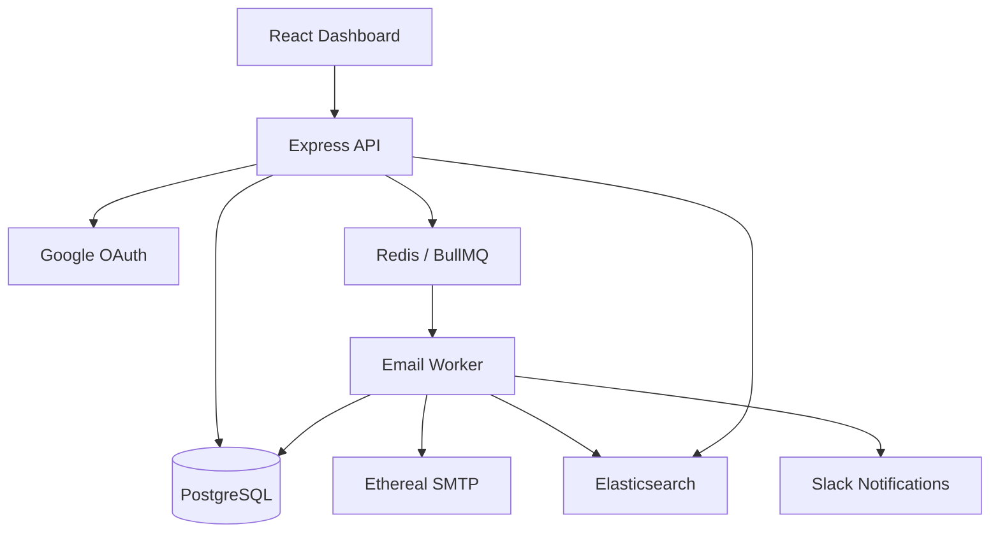

# ReachInbox — Email Scheduling & Automation

A full-stack email scheduling application with a React dashboard, a TypeScript/Express API, background email delivery, searchable email history, and Slack delivery notifications.

> **Project status:** Built and tested locally. Ethereal is used as the SMTP test service; messages are captured for preview, **not delivered to real recipients**. The project is not presented as a production-ready email service.

## Features

- Google OAuth authentication and user-scoped email data
- React dashboard for composing and scheduling emails
- Registered sender selection, recipient, subject, body, and scheduled send time
- PostgreSQL storage for email jobs, sender accounts, and delivery status
- Redis + BullMQ for delayed jobs and background processing
- Worker-level controls for rate limiting, minimum send delays, and rescheduling
- SMTP test delivery through Nodemailer and Ethereal
- Email search backed by Elasticsearch
- Slack OAuth connection and automatic sent-email notifications
- Read-only Bull Board queue dashboard for local monitoring

## Technology stack

| Layer | Technology |
|---|---|
| Frontend | React, TypeScript, Vite, Tailwind CSS |
| Backend | Node.js, Express, TypeScript |
| Database | PostgreSQL |
| Background work | Redis, BullMQ |
| Test email | Nodemailer, Ethereal SMTP |
| Search | Elasticsearch |
| Authentication | Google OAuth |
| Notifications | Slack OAuth and incoming webhooks |
| Local services | Docker Compose |

## High-level architecture



## Repository layout

```text
ReachInbox/
├── backend/
│   ├── src/                # API, scheduling, worker, integrations
│   ├── sql/                # Database migrations
│   ├── .env.example        # Variable names only; no credentials
│   └── package.json
├── frontend/
│   ├── src/                # React UI
│   └── package.json
├── compose.yaml            # Local service definitions
└── README.md
```

## Local setup

### Prerequisites

- Node.js and npm (use a version compatible with both `package.json` files)
- Docker Desktop with Docker Compose
- Google OAuth application credentials
- Slack app credentials with `chat:write` and `incoming-webhook` bot scopes
- Ethereal test SMTP credentials

### 1. Install dependencies

From the repository root:

```bash
cd backend && npm install
cd ../frontend && npm install
cd ..
```

### 2. Start infrastructure

```bash
docker compose up -d
```

Confirm that PostgreSQL, Redis, and Elasticsearch are healthy before proceeding. Inspect `compose.yaml` for service settings and ports.

### 3. Configure the backend

```bash
cp backend/.env.example backend/.env
```

Fill in the **local** `.env` using your own credentials and the environment-variable references in `backend/src`. Some variables are optional or have code defaults; the example intentionally does not contain secrets or claim that every setting is mandatory.

Configure the Google OAuth and Slack redirect URLs to match the routes and port in your local backend. The locally tested Slack redirect URL was `http://localhost:4000/auth/slack/callback`.

**Never commit `.env`, access tokens, encryption keys, OAuth client secrets, or real webhook URLs.**

### 4. Apply database migrations

The SQL files are located in `backend/sql`. Review them and apply them in their intended numbered order, according to the existing database state. For example, this command applies the Slack deduplication migration **only if it has not already been applied**:

```bash
cd backend
docker compose -f ../compose.yaml exec -T postgres \
  psql -v ON_ERROR_STOP=1 -U reachinbox -d reachinbox \
  < sql/006_slack_delivery_dedupe.sql
```

On a fresh database, apply the prerequisite schema migrations first. Do not assume this example is sufficient to initialize the complete database.

### 5. Start the backend and background worker

In separate terminals:

```bash
cd backend
npx tsx src/server.ts
```

```bash
cd backend
EMAIL_WORKER_ENABLED=true WORKER_CONCURRENCY=1 npx tsx src/emailWorker.ts
```

Backend (local): `http://localhost:4000`.

**Keep the worker running** while scheduled emails are pending. Use the local backend environment configuration for the database, Redis, SMTP, and Slack connections.

### 6. Start the frontend

```bash
cd frontend
npm run dev
```

Frontend: `http://localhost:5173` (or the URL shown by Vite).

### 7. Optional: read-only queue monitor

If configured and started with the backend's Bull Board entry point, the local queue dashboard is available at `http://localhost:4001/admin/queues`. It is a development tool and should not be exposed publicly without access controls.

## Scheduling and delivery flow

1. A user signs in with Google and selects a registered sender.
2. The user enters a recipient, subject, message, and future delivery time.
3. The API validates and stores the email job in PostgreSQL.
4. BullMQ schedules the delayed job in Redis.
5. The worker claims the job and applies sending safeguards.
6. Nodemailer submits the email to Ethereal SMTP.
7. PostgreSQL stores the delivery status, attempt count, and preview URL.
8. Delivery integrations update Elasticsearch and send Slack notifications.
9. The React dashboard displays email history and search results.

## Development verification

The following behaviors were observed during local testing:

- Backend typecheck and build succeeded.
- Frontend Vite production build succeeded.
- A React-scheduled email transitioned to `sent`, with one send attempt and an Ethereal preview URL.
- An automatically processed email posted a `✅ Email sent` notification in `#reachinbox-alerts`.
- The same test email was found in Elasticsearch with `status: sent`.

To repeat build checks:

```bash
cd backend && npm run typecheck && npm run build
cd ../frontend && npm run build
```

## Security and deployment notes

- Keep all credentials in an untracked `.env` or managed secret store.
- The included `.env.example` contains **names and blank placeholders**, not working secrets.
- Webhooks should remain encrypted at rest using the application-provided encryption key.
- Do not expose the development server or queue-monitoring endpoints to the public internet.
- Add production-grade logging, retry/outbox guarantees for notification side effects, security review, and deployment configuration before using with real recipients.
- This project has been tested with Ethereal. Real email delivery would need a production SMTP provider and additional domain/deliverability configuration.

## Screenshots

Add your own dashboard, scheduling form, Slack alert, and queue-monitor screenshots to a `screenshots/` folder if required by the submission instructions. Avoid showing API keys, webhook URLs, or personal data.

## License

No license has been selected.
